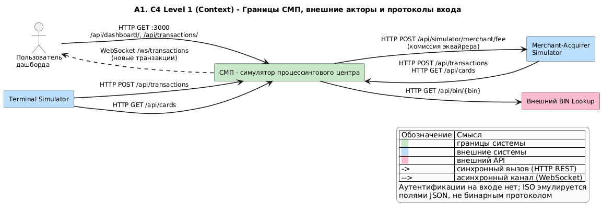

# А1. C4 Level 1 - Context
## Чего не хватало и что сделано

- В исходной документации проекта Context-диаграмма отсутствовала. В `docs/architecture.md` только общая диаграмма сервисов
- Сделано: СМП выделена в единый «чёрный ящик», а за её пределами зафиксированы 4 внешних актора/системы и протоколы их взаимодействия
- Размечены типы связей. сплошная стрелка - HTTP REST запрос, пунктирная - асинхронный поток по WebSocket.

---

## Диаграмма

## Подтверждение кодом

| Связь | Где в коде |
|---|---|
| Терминал -> СМП: `POST /api/transactions` | [`GatewayClient.java`](../../../services/terminal-simulator/src/main/java/com/processing/terminalsimulator/client/GatewayClient.java) - метод `sendToGateway()`, вызов `rest.post().uri(gatewayUrl + "/api/transactions")` |
| Терминал -> СМП: `GET /api/cards` | [`GatewayClient.java`](../../../services/terminal-simulator/src/main/java/com/processing/terminalsimulator/client/GatewayClient.java) - метод `getCardsFromCardManager()`, вызов `cardManagementUrl + "/api/cards"` (в `docker-compose.yaml`) `CARD_MGMT_URL=http://card-management:8080`, напрямую в CMS в обход Gateway) |
| Мерчант -> СМП: транзакции и карты | [`GatewayClient.java`](../../../services/terminal-simulator/src/main/java/com/processing/terminalsimulator/client/GatewayClient.java) - методы `processAuthorize()` (`POST /api/transactions`, до 3 ретраев при HTTP 429) и `getCards()` (`GET /api/cards` через Gateway) |
| СМП -> Мерчант: расчёт комиссии | [`MerchantAcquirerClient.java`](../../../services/switch/src/main/java/com/processing/service/MerchantAcquirerClient.java) - метод `fetchAcquiringFee()` (`POST /api/simulator/merchant/fee`); контроллер `SimulationController.java` |
| СМП -> BIN Lookup | [`BinLookupClient.java`](../../../services/authorization/src/main/java/com/processing/authorization/client/BinLookupClient.java) - `GET /api/bin/{bin}`, таймауты в [`application.yaml`], при сбое возвращает `Optional.empty()` |
| Пользователь -> СМП (HTTP) | [`nginx.conf`](../../../services/dashboard/nginx.conf) - проксирование `/api/` в `gateway`; хуки `useStats.ts`, `useTransactions.ts`, `useExportCsv.ts` |
| СМП -> Пользователь (WebSocket) | [`nginx.conf`](../../../services/dashboard/nginx.conf) - проксирование `/ws/` напрямую в `transaction-logger`; `useWebSocket.ts`, `WebSocketConfig.java` |
| Входные маршруты | [`application.yml`](../../../services/gateway/src/main/resources/application.yml) - маршруты `/api/transactions`, `/api/transactions/**`, `/api/dashboard/**`, `/api/cards/**`, `/api/simulator/**` |

## Для чего пригодится

Определяет контур для E2E-тестирования (модуль 7): показывает внешние точки входа и помогает решить, какие внешние системы нужно поднимать/эмулировать для генерации нагрузки (Terminal Simulator, Merchant Simulator), а какие можно заглушить или отключить