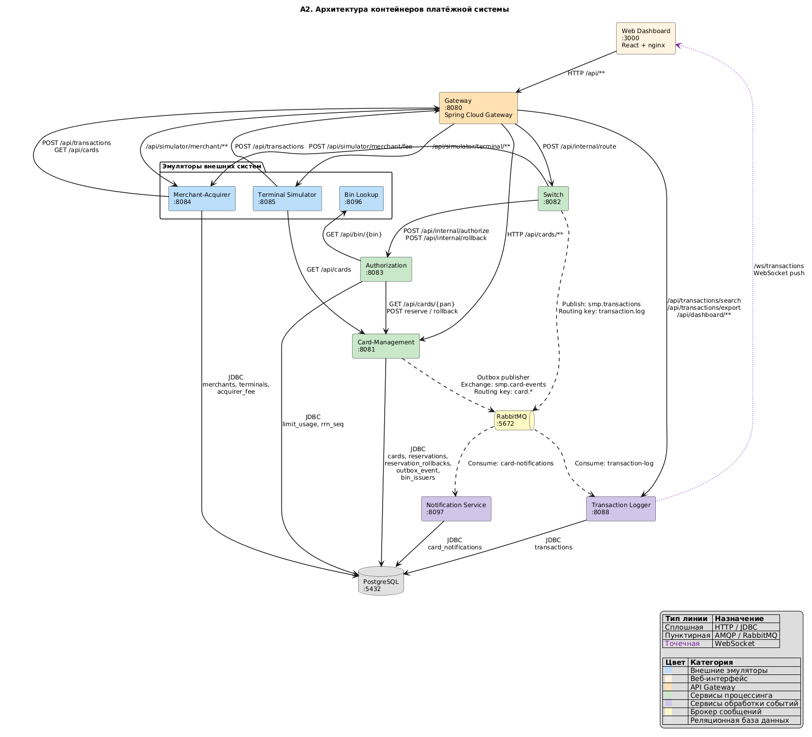

# A2. C4 Level 2 - Container
## Чего не хватало и что сделано

- Все стрелки в `docs/architecture-diagram.puml` и схеме в `docs/architecture.md` одинаковые. Синхронные и асинхронные не отличаются
- Не хватает связей: Terminal Simulator -> Card-Management, Dashboard -> Logger по WebSocket, Switch -> Merchant-Acquirer, Merchant-Acquirer -> PostgreSQL

### Сделано: 
- Диаграмма собранная по `docker-compose.yaml` и классам в коде
- Связи симуляторов и дашборда описаны в [a1-context.md](a1-context.md)

## Диаграмма

## Подтверждение кодом
| Связь | Тип                                                                                                                                                                                                            | В коде                                                                                                                                                                                                                    |
|---|----------------------------------------------------------------------------------------------------------------------------------------------------------------------------------------------------------------|---------------------------------------------------------------------------------------------------------------------------------------------------------------------------------------------------------------------------|
| Gateway -> сервисы | HTTP                                                                                                                                                                                                           | [`gateway/application.yml`](../../../services/gateway/src/main/resources/application.yml) - `RewritePath=/api/transactions, /api/internal/route`                                                                          |
| Switch -> Authorization | HTTP                                                                                                                                                                                                           | [`AuthorizationClient.java`](../../../services/switch/src/main/java/com/processing/service/AuthorizationClient.java) - `callAuthorize`, `rollback`                                                                        |
| Switch -> Merchant-Acquirer | HTTP                                                                                                                                                                                                           | [`MerchantAcquirerClient.java`](../../../services/switch/src/main/java/com/processing/service/MerchantAcquirerClient.java) - `POST /api/simulator/merchant/fee`                                                           |
| Authorization -> Card-Management | HTTP                                                                                                                                                                                                           | [`CardManagementClientImpl.java`](../../../services/authorization/src/main/java/com/processing/authorization/client/CardManagementClientImpl.java) - `getCard`, `reserve`, `rollback`                                     |
| Authorization -> Bin Lookup | HTTP                                                                                                                                                                                                       | [`BinLookupClient.java`](../../../services/authorization/src/main/java/com/processing/authorization/client/BinLookupClient.java) - `getIssuerId`: `GET /api/bin/{bin}`                                                    |
| Authorization -> PostgreSQL | JDBC                                                                                                                                                                                                           | [`LimitUsageRepository.java`](../../../services/authorization/src/main/java/com/processing/authorization/repositories/LimitUsageRepository.java) - `upsertLimitUsage`, `fetchRrnBlock`                                    |
| Card-Management -> PostgreSQL | JDBC                                                                                                                                                                                                           | [`CardJpaRepository.java`](../../../services/card-management/src/main/java/com/processing/cardmanagement/repositories/CardJpaRepository.java) - `findByPan`, `findWithPessimisticLockByPan`                               |
| Transaction Logger -> PostgreSQL | JDBC                                                                                                                                                                                                           | [`TransactionRepository.java`](../../../services/transaction-logger/src/main/java/com/processing/transactionlogger/repository/TransactionRepository.java) - `saveAndFlush` в `TransactionService.store`                   |
| Notification Service -> PostgreSQL | JDBC                                                                                                                                                                                                           | [`CardNotificationRepository.java`](../../../services/notification-service/src/main/java/com/processing/notification/repository/CardNotificationRepository.java) - `repository.save` в `CardEventListener.handleCardEvent` |
| Merchant-Acquirer -> PostgreSQL | JDBC                                                                                                                                                                                                           | [`MerchantRepository.java`](../../../services/merchant-acquirer/src/main/java/com/processing/merchantacquirer/repository/MerchantRepository.java), `TerminalRepository`, `AcquirerFeeRepository`                          |
| Card-Management -> RabbitMQ | AMQP                                                                                                                                                                                                           | [`OutboxProcessor.java`](../../../services/card-management/src/main/java/com/processing/cardmanagement/services/OutboxProcessor.java) - `process` по расписанию вызывает `processSingleEvent`                             |
| Switch -> RabbitMQ | AMQP                                                                                                                                                                                                           | [`LoggerClient.java`](../../../services/switch/src/main/java/com/processing/service/LoggerClient.java) - `rabbitTemplate.convertAndSend(EXCHANGE, ROUTING_KEY, transaction)`                                              |
| RabbitMQ -> Logger | AMQP | [`TransactionLogListener.java`](../../../services/transaction-logger/src/main/java/com/processing/transactionlogger/listener/TransactionLogListener.java) - `@RabbitListener(queues = "transaction-log")`                 |
| RabbitMQ -> Notification | AMQP                                                                                                                                                                                                           | [`CardEventListener.java`](../../../services/notification-service/src/main/java/com/processing/notification/listener/CardEventListener.java) - `@RabbitListener(queues = "card-notifications")`                           |

## Что есть в коде но нет в документации
- В задании и README - 11 сервисов, а в `docker-compose.yaml` 10 контейнеров (плюс PostgreSQL и RabbitMQ). В `services/` кроме них лежат только библиотека `common` и модуль `e2e-tests`
- В Gateway нет маршрутов для Notification Service и Bin Lookup, они доступны только по своим портам

## Для чего пригодится
- **Синхронные HTTP-стрелки** являются прямыми кандидатами на покрытие API-контрактными тестами 
- **Асинхронные AMQP-стрелки** и стрелки к БД определяют границы для написания интеграционных тестов 

