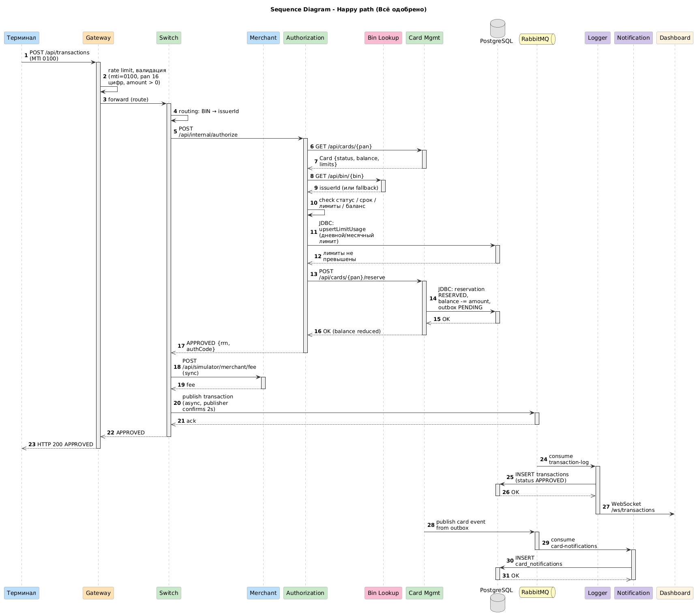
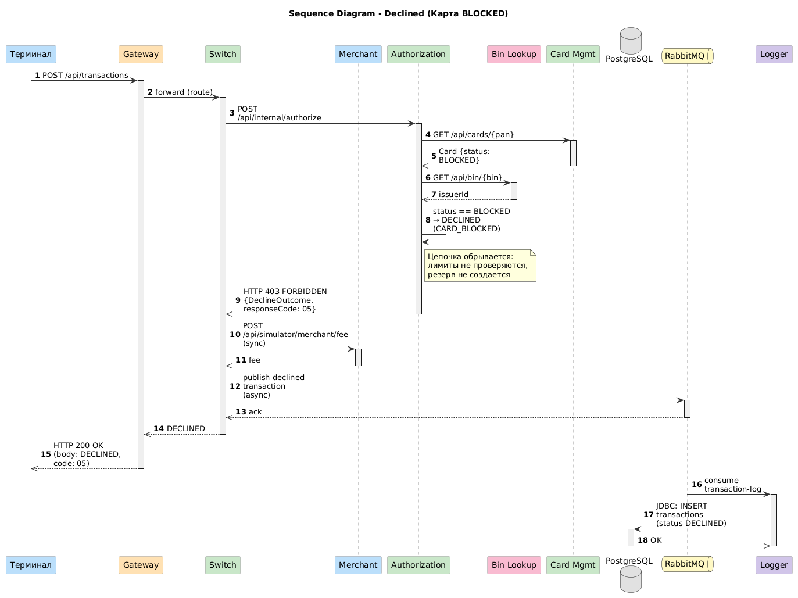
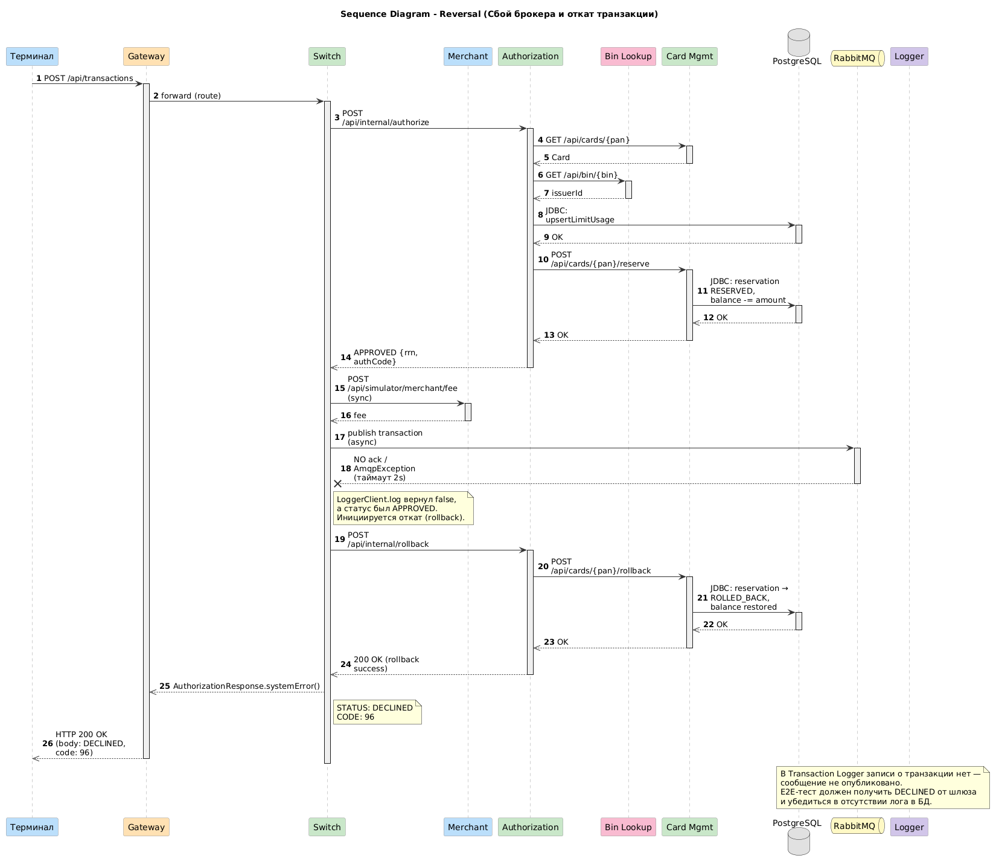

# A4. Sequence
## Чего не хватало и что сделано

Mermaid sequence в architecture.md покрывает только happy path. Нет declined и reversal, хотя в коде есть и DeclineOutcome (все ветки отказа), и publisherConfirmType=CORRELATED с откатом

Сделано: 3 диаграммы отображающие течение транзакций при разных сценариях

- Sync (HTTP) - цепочка до ответа клиенту: Gateway -> Switch -> Authorization -> (Bin Lookup, Card Management) -> резервирование
- Async (AMQP) - публикация в RabbitMQ -> Logger. Запись в Logger появляется не в момент ответа клиенту, а позже. E2E-тест должен ждать условие

## Диаграммы
### Happy path (всё одобрено. Gateway -> Switch -> Authorization -> (Bin Lookup, Card-Management) -> резервирование -> асинхронная публикация в Logger)

### Declined (карта BLOCKED: синхронная цепочка обрывается на Authorization, возвращается DECLINED с причиной (DeclineOutcome.CARD_BLOCKED))

### Reversal (Switch не получил publisher-confirm от брокера за 2 секунды и откатывает резервирование)

## Подтверждение кодом

### Общее

| Действие | Файл | Строки кода |
|---|---|---|
| **Terminal и Merchant отправляют транзакцию в Gateway** | [`GatewayClient.java`](../../../services/terminal-simulator/src/main/java/com/processing/terminalsimulator/client/GatewayClient.java) [`GatewayClient.java`](../../../services/merchant-acquirer/src/main/java/com/processing/merchantacquirer/client/GatewayClient.java) | HTTP-запрос `POST` на `/api/transactions`, метод `sendToGateway` |
| **Gateway сначала применяет rate limit, потом валидацию** | [`TransactionRateLimitFilter.java`](../../../services/gateway/src/main/java/com/processing/gateway/ratelimit/TransactionRateLimitFilter.java) [`TransactionValidationFilter.java`](../../../services/gateway/src/main/java/com/processing/gateway/validation/TransactionValidationFilter.java) | Очередность через `getOrder`: `HIGHEST_PRECEDENCE + 1` и `HIGHEST_PRECEDENCE + 2`; `validator.validate(authorizationRequest)` |
| **Switch определяет issuerId по BIN и вызывает Authorization** | [`RouteService.java`](../../../services/switch/src/main/java/com/processing/service/RouteService.java) [`AuthorizationClient.java`](../../../services/switch/src/main/java/com/processing/service/AuthorizationClient.java) | `routingService.getIssuerIdByPan(pan)`, затем `authorizationClient.authorize(routedRequest)`. HTTP-запрос `POST /api/internal/authorize` (метод `callAuthorize`) |
| **Authorization получает карту из Card-Management** | [`AuthServiceImpl.java`](../../../services/authorization/src/main/java/com/processing/authorization/services/AuthServiceImpl.java) [`CardManagementClientImpl.java`](../../../services/authorization/src/main/java/com/processing/authorization/client/CardManagementClientImpl.java) | Вызов `cardManagementClient.getCard(request.pan())` (HTTP `GET /api/cards/{pan}`) |
| **Switch запрашивает комиссию у Merchant-Acquirer** | [`RouteService.java`](../../../services/switch/src/main/java/com/processing/service/RouteService.java) [`MerchantAcquirerClient.java`](../../../services/switch/src/main/java/com/processing/service/MerchantAcquirerClient.java) | Вызов `acquiringFeeClient.fetchAcquiringFee(...)` при любом статусе; запрос `POST /api/simulator/merchant/fee` |
| **Switch публикует транзакцию в RabbitMQ** | [`RouteService.java`](../../../services/switch/src/main/java/com/processing/service/RouteService.java) [`LoggerClient.java`](../../../services/switch/src/main/java/com/processing/service/LoggerClient.java) | Вызов `tryLog(transaction)`, публикация через `rabbitTemplate.convertAndSend(EXCHANGE, ROUTING_KEY, transaction)` |
| **Logger получает сообщение, сохраняет и рассылает по WebSocket** | [`TransactionLogListener.java`](../../../services/transaction-logger/src/main/java/com/processing/transactionlogger/listener/TransactionLogListener.java) [`TransactionService.java`](../../../services/transaction-logger/src/main/java/com/processing/transactionlogger/service/TransactionService.java) | Метод `handleTransaction` вызывает `transactionService.store(request)`; методы `saveAndFlush` и `webSocketManager.broadcast` |

### Happy path

| Действие | Файл | Строки кода |
|---|---|---|
| **Bin Lookup (результат используется только для лога)** | [`AuthServiceImpl.java`](../../../services/authorization/src/main/java/com/processing/authorization/services/AuthServiceImpl.java) [`BinLookupClient.java`](../../../services/authorization/src/main/java/com/processing/authorization/client/BinLookupClient.java) | `binLookupClient.getIssuerId(pan).ifPresentOrElse(issuerId -> log.info(...), ...)` |
| **Проверки статуса, срока и баланса** | [`AuthServiceImpl.java`](../../../services/authorization/src/main/java/com/processing/authorization/services/AuthServiceImpl.java) | `!currCardStatus.equals(CardModelStatus.ACTIVE)`, `lastValidDay.isBefore(transmissionDate)`, `request.amount().compareTo(cardResponse.availableBalance()) > 0` |
| **Учёт лимитов и генерация RRN** | [`AuthServiceImpl.java`](../../../services/authorization/src/main/java/com/processing/authorization/services/AuthServiceImpl.java) [`LimitUsageRepository.java`](../../../services/authorization/src/main/java/com/processing/authorization/repositories/LimitUsageRepository.java) | `checkAndUpdateLimits` (через `limitUsageRepository.upsertLimitUsage`) и `generateRRN` (через `limitUsageRepository.fetchRrnBlock`) |
| **Резервирование (одной транзакцией БД)** | [`AuthServiceImpl.java`](../../../services/authorization/src/main/java/com/processing/authorization/services/AuthServiceImpl.java) [`CardServiceImpl.java`](../../../services/card-management/src/main/java/com/processing/cardmanagement/services/CardServiceImpl.java) | `cardManagementClient.reserve(amount, rrn, pan)`. В `CardServiceImpl` внутри `transactionRunner.runSupplier` идут `reservationRepository.save`, `cardRepository.update` и `eventNotifier.notifyListeners` |
| **Событие карты уходит через outbox в Notification** | [`OutboxProcessor.java`](../../../services/card-management/src/main/java/com/processing/cardmanagement/services/OutboxProcessor.java) [`CardEventListener.java`](../../../services/card-management/src/main/java/com/processing/cardmanagement/events/CardEventListener.java) | Обработка outbox по расписанию; интерфейс `CardEventListener` сохраняет уведомление (метод `handleCardEvent`) |

### Declined

| Действие | Файл | Строки кода |
|---|---|---|
| **Карта BLOCKED обрывает цепочку до лимитов и резерва** | [`AuthServiceImpl.java`](../../../services/authorization/src/main/java/com/processing/authorization/services/AuthServiceImpl.java) [`DeclineOutcome.java`](../../../services/authorization/src/main/java/com/processing/authorization/constants/DeclineOutcome.java) | Ветка `case CardModelStatus.BLOCKED` возвращает `DeclineOutcome.CARD_BLOCKED.buildAuthorization(...)`. Исходу соответствует код `05` |
| **Authorization отвечает HTTP 403, но Switch берёт решение из тела** | [`AuthControllerImpl.java`](../../../services/authorization/src/main/java/com/processing/authorization/controller/AuthControllerImpl.java) [`AuthorizationClient.java`](../../../services/switch/src/main/java/com/processing/service/AuthorizationClient.java) | Маппинг `REASON_CARD_BLOCKED` и др. на `HttpStatus.FORBIDDEN`. Клиент не бросает ошибку на 403 (пустой `onStatus`), Switch разбирает тело |

### Reversal

| Действие | Файл | Строки кода |
|---|---|---|
| **Публикация не удалась** | [`LoggerClient.java`](../../../services/switch/src/main/java/com/processing/service/LoggerClient.java) | `catch (AmqpException e) { ... return false; }` |
| **Откат средств по цепочке (Switch -> Auth -> CMS)** | [`RouteService.java`](../../../services/switch/src/main/java/com/processing/service/RouteService.java) [`AuthorizationClient.java`](../../../services/switch/src/main/java/com/processing/service/AuthorizationClient.java) [`AuthServiceImpl.java`](../../../services/authorization/src/main/java/com/processing/authorization/services/AuthServiceImpl.java) [`CardServiceImpl.java`](../../../services/card-management/src/main/java/com/processing/cardmanagement/services/CardServiceImpl.java) | Условие `if (!logged && STATUS_APPROVED.equals(response.status()))`; вызов `POST /api/internal/rollback`; методы `reservation.rolledBack(rollback)` и `card.withRollback(rollback)` |
| **Клиент получает DECLINED с кодом 96 (записи в журнале нет)** | [`RouteService.java`](../../../services/switch/src/main/java/com/processing/service/RouteService.java) [`AuthorizationResponse.java`](../../../services/common/src/main/java/com/processing/common/dto/authorization/AuthorizationResponse.java) | Сразу после отката возврат `AuthorizationResponse.systemError(request.stan())`; ответ задает `"96"` и `"DECLINED"` без повторной публикации |

## Для чего пригодится
- Для E2E и интеграционного тестирования