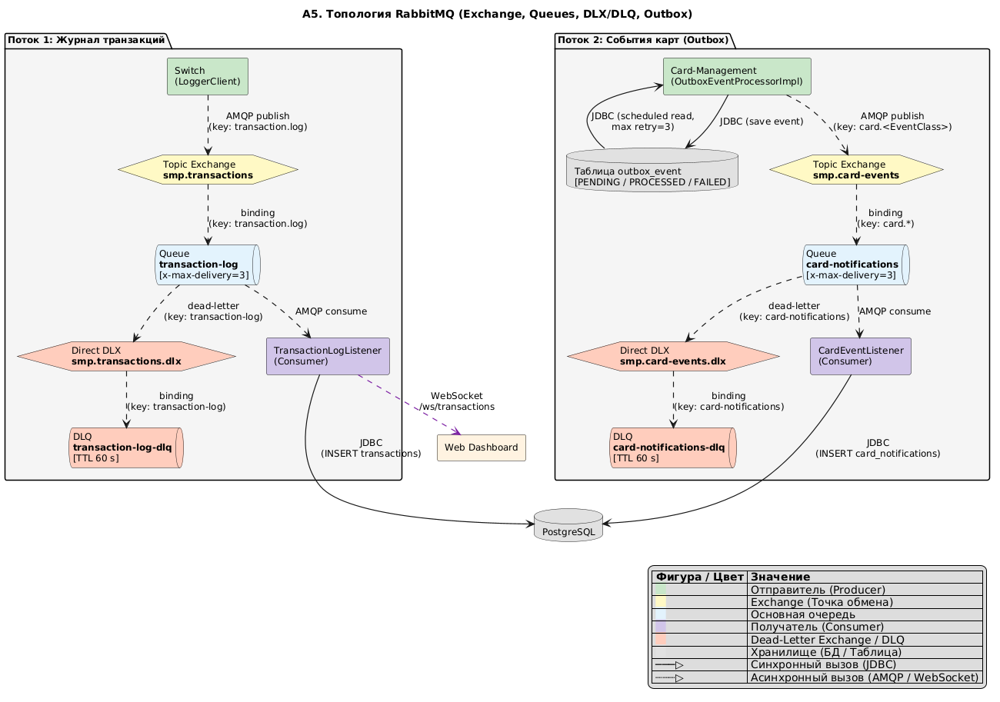

# А5. RabbitMQ Топология и обработка сбоев

## Чего не хватало и что сделано

- **Проблема старой документации:** На базовых схемах брокер сообщений был показан узлом `RabbitMQ`. Не были описаны механизмы гарантии доставки, роутинга, обработки ошибок и паттерна Outbox
- **Что сделано:** Спроектирована детальная диаграмма топологии RabbitMQ для двух основных потоков: журнала транзакций и событий карт
- На схеме явно выделены механизмы **Dead Letter Exchange (DLX)** и **Dead Letter Queue (DLQ)** с настроенными TTL и лимитами попыток 
- Раскрыт цикл жизни сообщений в паттерне Outbox (сохранение в БД -> поллинг -> отправка в брокер)

## Диаграмма

## Подтверждение кодом

Каждая логическая связь подтверждается конфигурациями и реализацией в коде проекта.

### Поток 1: Switch -> Logger (Журнал транзакций)

| Действие | Файл | Строки кода |
|---|---|---|
| **Конфигурация топологии (Switch / Logger)** | [`RabbitMQConfig.java`](../../../services/switch/src/main/java/com/processing/config/RabbitMQConfig.java) [`RabbitMQConfig.java`](../../../services/transaction-logger/src/main/java/com/processing/transactionlogger/config/RabbitMQConfig.java) | Настройка `exchange`, `queue`, `DLX`, `DLQ`. Аргументы очереди: `x-max-delivery=3`, `x-dead-letter-exchange`. TTL для DLQ: `60s`. Зеркально настроено в обоих сервисах. |
| **Publisher Confirms** | [`application.yml`](../../../services/switch/src/main/resources/application.yml) | Настройка гарантии публикации: `spring.rabbitmq.publisher-confirm-type: correlated`. |
| **Отправитель (Producer)** | [`LoggerClient.java`](../../../services/switch/src/main/java/com/processing/service/LoggerClient.java) | Публикация через `rabbitTemplate.convertAndSend(EXCHANGE, ROUTING_KEY, transaction)`. Ключ маршрутизации: `transaction.log`. |
| **Получатель (Consumer)** | [`TransactionLogListener.java`](../../../services/transaction-logger/src/main/java/com/processing/transactionlogger/listener/TransactionLogListener.java) [`TransactionService.java`](../../../services/transaction-logger/src/main/java/com/processing/transactionlogger/service/TransactionService.java) | Слушатель `@RabbitListener(queues = "transaction-log")`. Сохранение транзакции в БД через `TransactionService`. |

### Поток 2: Card Management -> Notification (События карт)

| Действие | Файл | Строки кода |
|---|---|---|
| **Конфигурация топологии** | [`RabbitMQConfig.java`](../../../services/card-management/src/main/java/com/processing/cardmanagement/config/RabbitMQConfig.java) | Настройка exchange `smp.card-events`, очереди `card-notifications` и её dead-letter маршрутов (DLX/DLQ). |
| **Transactional Outbox (БД)** | [`OutboxEventProcessorImpl.java`](../../../services/card-management/src/main/java/com/processing/cardmanagement/services/OutboxEventProcessorImpl.java) [`OutboxProcessor.java`](../../../services/card-management/src/main/java/com/processing/cardmanagement/services/OutboxProcessor.java) | Сохранение события со статусами `PENDING / PROCESSED / FAILED`. Шедулер `@Scheduled` читает `PENDING` из БД с `retryCount < 3`. |
| **Отправитель (Producer)** | [`OutboxEventProcessorImpl.java`](../../../services/card-management/src/main/java/com/processing/cardmanagement/services/OutboxEventProcessorImpl.java) | Публикация в брокер с динамическим ключом: `rabbitTemplate.convertAndSend(EXCHANGE, "card." + EventClass, event)`. |
| **Получатель (Consumer)** | [`CardEventListener.java`](../../../services/card-management/src/main/java/com/processing/cardmanagement/events/CardEventListener.java) | Слушатель `@RabbitListener(queues = "card-notifications")`. Запись уведомления в таблицу `card_notifications`. |

## Механика обработки отказов (DLX / DLQ)
Она идентична для обоих потоков:
1. **Retry:** Если Consumer выбрасывает исключение, брокер возвращает сообщение обратно в очередь. Количество повторных попыток ограничено параметром `x-max-delivery=3`.
2. **DLQ:** При исчерпании 3 попыток доставки сообщение отвергается брокером и маршрутизируется через Dead-Letter Exchange (DLX) в соответствующую мёртвую очередь (`transaction-log-dlq` или `card-notifications-dlq`).
3. **TTL:** Сообщения в DLQ автоматически удаляются по истечении 60 секунд (настройка `TTL 60s`), что предотвращает бесконечное переполнение хранилища при затяжных сбоях.

## Для чего пригодится
Данная схема является главным артефактом для написания **интеграционных тестов (Модуль 6)**. Она показывает:
- Где тестировать успешную доставку (потребление из основной очереди -> проверка записи в БД).
- Где тестировать механизм *retry* (падение consumer-а и повторные доставки до 3 раз).
- Как протестировать DLQ (генерация заведомо битого сообщения (poison pill) и проверка его появления в DLQ-очереди).
- Правильность работы Outbox (от сохранения события в таблице `outbox_event` до его вычитывания планировщиком).