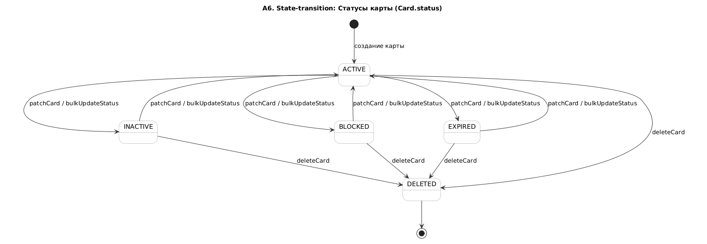
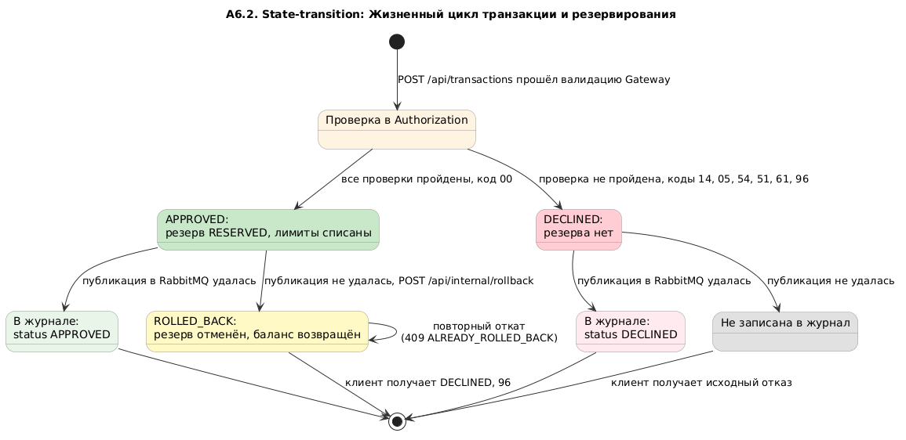

# A6 - State-transition: Card.status и жизненный цикл Transaction

## Чего не хватало и что сделано

- Диаграмм состояний в проекте не было. В документации статусы только перечислены, переходы и их причины не описаны.
- Сделано: две диаграммы по коду - статус карты (`CardStatus`) и жизненный цикл транзакции/резервирования. У каждого перехода подписано, каким вызовом он выполняется.

## Диаграммы

### 1. Card.status

### 2. Жизненный цикл транзакции и резервирования

В модели `TransactionStatus` есть только `APPROVED` и `DECLINED`; запись в журнале после сохранения не меняется. `ROLLED_BACK` - фактическое состояние `ReservationStatus`, показано как логическое завершение операции после отмены ранее одобренного резервирования, а не как значение `transactions.status`.

## Подтверждение кодом

### Статусы карты (Card.status)

| Бизнес-правило | Файл | Строки кода |
|---|---|---|
| **Набор статусов** | [`CardStatus.java`](../../../services/card-management/src/main/java/com/processing/cardmanagement/models/CardStatus.java) | `ACTIVE`, `INACTIVE`, `BLOCKED`, `EXPIRED`, `DELETED` |
| **Создание карты (`ACTIVE`)** | [`CardServiceImpl.java`](../../../services/card-management/src/main/java/com/processing/cardmanagement/services/CardServiceImpl.java) | Метод `createCard` (новая карта создается со статусом `ACTIVE`) |
| **Смена статуса (`patchCard` / `bulkUpdateStatus`)** | [`CardServiceImpl.java`](../../../services/card-management/src/main/java/com/processing/cardmanagement/services/CardServiceImpl.java) [`Card.java`](../../../services/card-management/src/main/java/com/processing/cardmanagement/models/Card.java) | В сервисе вызываются методы смены; в `Card.java` метод `withData` проверяет только лимиты, направление перехода не ограничивает |
| **Допустимые статусы в PATCH** | [`PatchCardRequest.java`](../../../services/common/src/main/java/com/processing/common/dto/cardmanagement/PatchCardRequest.java) [`CardModelStatus.java`](../../../services/common/src/main/java/com/processing/common/dto/cardmanagement/CardModelStatus.java) | Ограничения DTO (в списке нет `DELETED`) |
| **Удаление (soft delete)** | [`Card.java`](../../../services/card-management/src/main/java/com/processing/cardmanagement/models/Card.java) [`CardEntity.java`](../../../services/card-management/src/main/java/com/processing/cardmanagement/models/CardEntity.java) | Метод `Card.deleted()`; аннотация хибернейта `@SQLRestriction("status <> 'DELETED'")` |
| **Резервирование только для `ACTIVE`** | [`Card.java`](../../../services/card-management/src/main/java/com/processing/cardmanagement/models/Card.java) [`GlobalExceptionHandler.java`](../../../services/card-management/src/main/java/com/processing/cardmanagement/configuration/GlobalExceptionHandler.java) | Вызов `Card.checkStatusOrThrow` -> `IllegalStateException` -> маппинг в HTTP 409 |
| **Отказ по статусу карты** | [`AuthServiceImpl.java`](../../../services/authorization/src/main/java/com/processing/authorization/services/AuthServiceImpl.java) [`DeclineOutcome.java`](../../../services/authorization/src/main/java/com/processing/authorization/constants/DeclineOutcome.java) | Проверка статуса при авторизации и генерация соответствующего кода отказа |

### Жизненный цикл транзакции и резервирования

| Бизнес-правило | Файл | Строки кода |
|---|---|---|
| **Статусы транзакции** | [`TransactionStatus.java`](../../../services/common/src/main/java/com/processing/common/dto/transactionlogger/TransactionStatus.java) | Только `APPROVED` и `DECLINED` |
| **Статусы резерва** | [`ReservationStatus.java`](../../../services/card-management/src/main/java/com/processing/cardmanagement/models/ReservationStatus.java) [`Reservation.java`](../../../services/card-management/src/main/java/com/processing/cardmanagement/models/Reservation.java) | `RESERVED`, `ROLLED_BACK`; смена статуса выполняется в методе `rolledBack` |
| **Повторный откат** | [`Reservation.java`](../../../services/card-management/src/main/java/com/processing/cardmanagement/models/Reservation.java) | Метод `Reservation.startRollback` выбрасывает `RollbackAlreadySatisfiedException` -> HTTP 409 -> `ALREADY_ROLLED_BACK` |
| **Ветка отката в Switch** | [`RouteService.java`](../../../services/switch/src/main/java/com/processing/service/RouteService.java) | Метод `route` (при неудачной публикации в брокер вызывается откат) |

## Что есть в коде но нет в документации
- **Автоматического перехода `ACTIVE` -> `EXPIRED` нет.** Планировщика, который менял бы статус по `expiryDate`, в коде нет. Authorization сам сравнивает срок с датой транзакции и отклоняет с кодом `54`, а статус карты остается `ACTIVE`. На диаграмме `EXPIRED` достижим только через PATCH.
- **У транзакции нет статуса `ROLLED_BACK`.** Это статус резерва в Card-Management. Отмененная транзакция в журнал не попадает, клиенту возвращается `DECLINED` с кодом `96`.
- **Переходы между четырьмя рабочими статусами карты не ограничены**: PATCH переводит из любого статуса в любой.

## Для чего пригодится

Каждый переход - отдельная проверка (E2E, модуль 7; state-transition, модуль 2)
- заблокировали карту -> транзакция отклонена -> разблокировали -> транзакция одобрена
- удалили карту -> карта не находится, транзакция отклонена с кодом `14`
- одобрили -> публикация не удалась -> резерв отменен, баланс вернулся
- повторный откат того же резерва -> 409